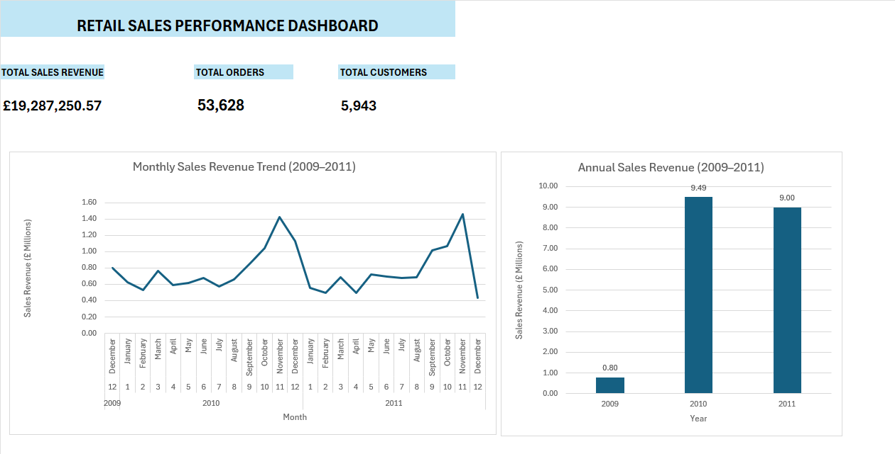

# Excel Sales Analysis Dashboard

## Project Overview
This project analyses retail sales data from 2009 to 2011 using Microsoft Excel. The objective is to monitor sales performance, analyse revenue trends, and present key business metrics in a clear dashboard.

## Tools and Skills
- Microsoft Excel
- PivotTables
- Excel formulas and cell references
- Line and column charts
- KPI reporting and dashboard design

## Key Performance Indicators
| Metric | Value |
|---|---:|
| Total Sales Revenue | £19,287,250.57 |
| Total Orders | 53,628 |
| Total Customers | 5,943 |

## Dashboard Preview

## Key Findings
- Total sales revenue was approximately £19.29 million.
- The dashboard reports 53,628 orders and 5,943 customers.
- Annual revenue was approximately £0.80 million in 2009, £9.49 million in 2010, and £9.00 million in 2011.
- Monthly sales revenue fluctuated, with noticeable peaks in late 2010 and late 2011.

## Project Files
- [Excel workbook](Excel_Sales_Analysis_Project_Backup.xlsx) — includes the dashboard, PivotTable data, monthly sales analysis, and raw data.
- [Dashboard image](Excel_Sales_Dashboard.png) — preview of the final dashboard.

## Conclusion
This project demonstrates how Excel can be used to analyse sales data, summarise business performance, and communicate insights through charts and KPIs.
